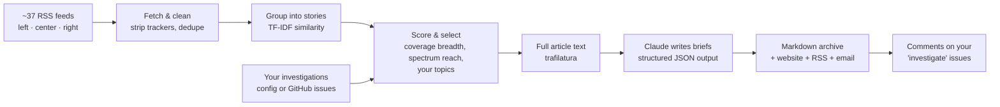

# 📰 Balanced News Digest

[](../../actions/workflows/digest.yml)
[](../../actions/workflows/tests.yml)

A personal news brief that builds itself **three times a day**. It reads free, paywall-free outlets from across
the political spectrum, finds the stories several of them are covering, and writes a short, neutral brief for
each one. Every brief shows **how the left, center and right framed the story** and links to every original
article, so you can check the sources yourself.

It runs on GitHub Actions: no server, nothing running on your computer. Each edition is published to a
GitHub Pages site and an RSS feed, can be emailed to you, and is archived in this repo as Markdown.

> **Latest edition:** [`LATEST.md`](LATEST.md) · **Website:** `https://<your-username>.github.io/<repo-name>/`

---

## What each story looks like

> ### Federal Reserve holds interest rates steady
> `Economy` · Covered by 5 outlets (L 1 · C 2 · R 2)
>
> A 3-5 sentence neutral summary, with contested claims attributed to whoever made them…
>
> **Key facts**: the numbers, votes and dates the articles agree on
> **How it's being framed**: **Left:** … · **Center:** … · **Right:** …
> **Disputed or unclear**: what's contested or still developing
> **Read it yourself**: a link to every source, labelled with its lean

Stories that only one side of the spectrum is covering get flagged: *⚠️ Mostly covered by right-leaning outlets*.

## How it works



**Design choices that keep it fair and honest:**

| Choice | Why |
|---|---|
| **Story selection is plain code, not AI.** | Which stories make the cut depends only on how many outlets cover them, whether coverage spans the spectrum, and your topics. That makes it testable and keeps a model's judgement out of what you see. |
| **Links never come from the AI.** | Claude only writes the prose. Outlet names, links and coverage counts are attached from the fetched data, so a source can't be made up. |
| **Sources are picked round-robin across the spectrum.** | Each story sends Claude a center, left and right article in turn, so no single side dominates what it reads. |
| **Structured output** (JSON schema) | Every brief has the same parts (facts, framing, disputes), and a bad response fails loudly instead of quietly. |
| **The model is told to attribute, not judge.** | It describes how each side framed the story, labels contested claims, and uses only the provided articles. |
| **It always works.** | With no API key, or if the API call fails, it falls back to a free basic mode that uses each outlet's own headline and summary. |

## Setup (about 10 minutes)

1. **Create the repo.** Push this folder to a new GitHub repository (public if you want to show it off).
2. **Add your Claude API key** (optional, but it's what writes the briefs). Get a key at
   [console.anthropic.com](https://console.anthropic.com), then go to **Settings → Secrets and variables →
   Actions → New repository secret**, named `ANTHROPIC_API_KEY`.
3. **Turn on the website.** Go to **Settings → Pages → Build and deployment → Source: GitHub Actions**.
4. **Create the `investigate` label.** Go to **Issues → Labels → New label** and name it `investigate`.
5. **Run it once.** Go to **Actions → Build digest → Run workflow**. After that it runs on its own, three
   times a day.

### Optional: email delivery

Add these repository secrets (for Gmail, create an [app password](https://myaccount.google.com/apppasswords)):

| Secret | Example |
|---|---|
| `SMTP_HOST` | `smtp.gmail.com` |
| `SMTP_PORT` | `465` |
| `SMTP_USER` | `you@gmail.com` |
| `SMTP_PASSWORD` | your app password |
| `DIGEST_EMAIL_TO` | `you@gmail.com` |

Or subscribe to the site's `feed.xml` in any RSS reader app to get a notification for each edition.

## Make it yours

| I want to… | Do this |
|---|---|
| **Change my topics** | Edit [`config/topics.yaml`](config/topics.yaml) on GitHub, or from your phone: **Actions → Manage topics → Run workflow** |
| **Follow a question or story** | Open an issue with the **🔎 Follow a story or question** template. Every edition checks all fetched articles for your keywords and **comments on the issue** when new coverage turns up. Close the issue to stop. |
| **Mute something** | Add words to `mute:` in `topics.yaml` |
| **Add or remove outlets** | Edit [`config/sources.yaml`](config/sources.yaml). Any RSS feed works; give it a `lean`. Then run **Actions → Check feeds** to confirm it works. |
| **Make an outlet count toward a topic** | Add its id under the topic's `sources:` (e.g. all Charlotte TV stations count as *Charlotte Local*) |
| **Get more stories on a topic** | Raise its `slots:` (stories reserved per edition) or `weight:` |
| **Change the schedule** | Edit the `cron:` lines in [`.github/workflows/digest.yml`](.github/workflows/digest.yml) (UTC) |
| **Change length, timezone, model** | [`config/settings.yaml`](config/settings.yaml) |

### Command line

```bash
pip install -r requirements.txt
python -m digest run --no-llm --dry-run                       # free test run, prints to terminal
python -m digest run                                          # full run (uses ANTHROPIC_API_KEY)
python -m digest topics add "Space" --keywords "nasa, spacex, rocket launch" --weight 1.5
python -m digest topics mute "crypto, nft"
python -m digest investigate "Will the Fed cut rates in December?" --keywords "federal reserve, rate cut"
python -m digest investigations list
python -m digest sources check                                # check every feed is working
python -m digest site                                         # build the website into _site/
```

## More than one digest: profiles

The same engine can run several digests, each with its own sources, topics and style. Each profile is a folder
in [`profiles/`](profiles/):

| Profile | Style | Website | Email secret |
|---|---|---|---|
| `main` ([`config/`](config/)) | **balanced**: left/center/right framing on every story | `/` | `DIGEST_EMAIL_TO` |
| `lighter` ([`profiles/lighter/`](profiles/lighter/)) | **light**: friendly and low-stress, heavy stories left out | `/lighter/` | `DIGEST_EMAIL_TO_LIGHTER` |

**The Lighter Brief** is for someone who wants to stay informed but finds the news too depressing. It covers
Jamaica, Charlotte, hip hop and celebrity news, cute animals, health and medical breakthroughs, and the
main US headlines. It draws mostly from center-rated outlets. Heavy stories are kept out in two ways: a mute list
(shootings, war and so on), and Claude marks any other grim story `too_heavy` so a spare one takes its place.
Gossip briefs say what's rumor and what's confirmed. Medical briefs say how far along the research is.

```bash
python -m digest --profile lighter run --no-llm --dry-run
python -m digest --profile lighter topics add "Food" --keywords "restaurant, recipe, chef"
```

To make your own, copy `profiles/lighter/` to `profiles/<name>/`, edit it, and add a build step for it in
`.github/workflows/digest.yml`.

## Cost

Basic mode is free. GitHub Actions is free for public repos, and a run takes about 2 minutes. Each profile is
billed separately, so two profiles cost about twice as much (the Lighter Brief sends fewer articles per story,
so it costs a bit less).

With Claude, each edition sends about 40-50K input tokens (8 stories × up to 6 articles) and gets back about
5-10K. These are rough estimates; check your usage in the Anthropic Console after a few runs:

| Model (`llm.model` in settings) | ≈ per edition | ≈ per month (3/day) |
|---|---|---|
| `claude-opus-5-5` (default, best writing) | $0.30-0.40 | ~$30 |
| `claude-sonnet-5-5` | $0.15-0.20 | ~$15 |
| `claude-haiku-5-5` | ~$0.01 | ~$1 |

Lowering `max_stories`, `max_articles_per_story` or `full_text_chars`, or setting `effort: low`, also cuts cost.

## About the lean ratings

The `lean` values in `sources.yaml` are approximate and based on the public
[AllSides](https://www.allsides.com/media-bias/ratings) and [Ad Fontes](https://adfontesmedia.com) charts.
Media bias ratings are debatable. They're kept in one editable file so you can check them and change them if
you disagree. The balance logic uses whatever you put there.

## Project layout

```
config/          sources, topics, investigations, settings (all YAML, all editable)
digest/
  fetch.py       parallel RSS fetching, URL cleanup, full-text extraction
  stories.py     TF-IDF clustering, scoring, balanced selection, blindspot detection
  summarize.py   Claude prompt + JSON schema; free basic-mode fallback
  pipeline.py    the end-to-end run
  render.py      Markdown, HTML site, RSS feed
  github.py      "investigate" issues → investigations + comments
  notify.py      SMTP email
templates/       Jinja templates for the site and the Markdown
archive/         every edition as JSON + Markdown (committed by the bot)
tests/           pytest suite with sample feeds (python tests/make_fixtures.py)
```

## Limitations

- Story grouping uses word overlap, so very differently worded headlines about the same event can end up as
  separate stories. Tune `cluster_threshold` in settings.
- Some sites block automated page downloads. When that happens the brief uses the RSS summary for that article.
- Feeds change and break sometimes. Failed feeds are listed at the bottom of each edition, and
  `python -m digest sources check` tests them all.
- AI summaries can still get things wrong. That's why every claim links back to the original reporting.

## License

MIT
